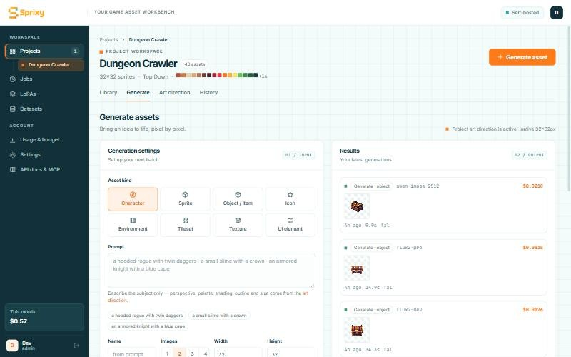
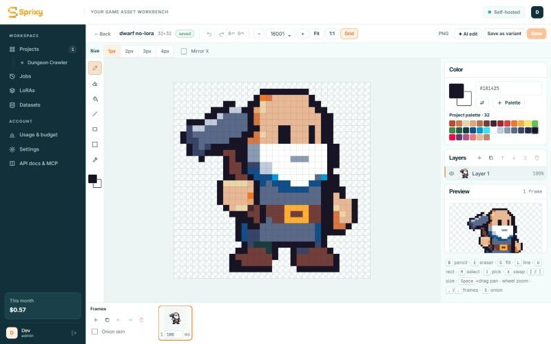
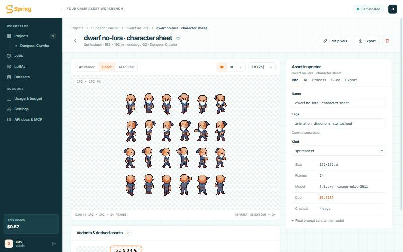

<p align="center">
  
</p>

<h1 align="center">Sprixy</h1>

<p align="center"><strong>Open-source, self-hosted AI studio for 2D game assets.</strong><br/>
Pixel-art sprites, characters, multi-direction views, animations, tilesets, textures, UI and icons —
generated with the AI models <em>you</em> choose, then turned into <em>true</em> pixel art by a deterministic engine.</p>

<p align="center">
  BYOK (fal.ai · OpenRouter) · No GPU needed · Docker / Coolify · REST API · MCP server for Claude Code
</p>

<p align="center"></p>
<p align="center"> </p>

---

## Why Sprixy

AI image models draw *pictures of* pixel art: blurry pseudo-pixels, hundreds of colors, off-grid edges, fake backgrounds.
Sprixy uses them for what they are good at (ideas, shapes, consistency through references and LoRAs) and then runs a
**free, deterministic post-processing engine** that snaps everything onto a real pixel grid, enforces your palette,
removes the background and cleans the edges. The result is an asset you can drop into a game engine.

Every project has an **art direction** (palette, native resolution, perspective, lighting, shading, detail level,
outline style, reference images, preferred models and LoRAs). Every prompt and every post-process step follows it,
so a whole game keeps a coherent look.

## Features

| Area | What you get |
| --- | --- |
| **Generation** | Characters, sprites, objects, icons, UI elements, environments, tilesets, seamless textures. 1–4 images per job, seeds, style references. |
| **Consistency** | Per-project art direction injected into prompts; palette lock; references; project LoRAs; variants keep the source palette. |
| **Characters** | 4 or 8 facing directions from one sprite (west-facing views mirrored for free) + direction spritesheet. |
| **Region edit** | Select a rectangle in the editor and describe a change: an edit model repaints it, palette-locked, and nothing outside the selection changes. |
| **Autotiles** | 16-tile Wang corner terrain sets built for free from two textures, exported as Godot terrain sets and Tiled wangsets. |
| **Animation** | Image-to-video (Wan) → frames extracted, background removed, pixelized, palette-locked, aligned; or an edit model drawing a sprite sheet that is auto-sliced. |
| **Models** | Multi-provider: fal.ai (Z-Image Turbo, FLUX.2 [klein] 4B/9B, Wan 2.2/2.6, BiRefNet, LoRA trainers) and every image model on OpenRouter (Gemini image, GPT-image, FLUX.2, Seedream, Qwen…). Choose per job by price, quality and capabilities. |
| **LoRAs** | Community presets, import by URL / Hugging Face id, train your own on fal.ai from an authorized dataset (cost shown and confirmed first), per-project LoRAs with strength. |
| **Free processing** | Background removal (flood fill / chroma key), true-grid pixelization with automatic grid detection, nearest-neighbour resize, palette reduction (median cut + OKLab k-means), palette mapping with 9 presets or your own, Floyd–Steinberg / Atkinson / Bayer dithering, outline, orphan & pinhole cleanup, recolor (HSL, palette swap), seamless tiles, trim/canvas/crop/flip, spritesheet slicing (grid or automatic), frame alignment. **No AI call, no cost.** |
| **Editor** | Layered pixel editor: pencil, eraser, fill, line, rectangle, selection (move / copy / paste), eyedropper, mirror drawing, palettes, 200-step history, zoom & pan, grid, frames, onion skin, live animation preview. |
| **Library** | Projects, search, kinds, tags, favorites, collections, variant trees, generation history with prompt and cost, batch processing / tagging / export. |
| **Export** | PNG (transparent), GIF, WebP (animated), spritesheet PNG + JSON atlas, metadata JSON, ZIP bundle, **Godot 4** (SpriteFrames / TileSet `.tres`), **Unity** (`.meta` with Point filtering + sprite slicing), **Phaser** (atlas + animations JSON + Tiled `.tsx`), **Aseprite** (`.aseprite` with layers and frames). Integer upscaling. |
| **Costs** | BYOK keys encrypted server-side (AES-256-GCM). Live prices from fal’s pricing API, real cost from OpenRouter. Estimates before every job, per-day/provider/model usage, monthly & daily budgets, per-job cap, daily job limit (HTTP 402 when exceeded). |
| **Team** | The admin creates accounts, gives each a monthly / daily spending allowance and can let them generate on the admin's provider keys — keys and provider balance stay hidden. Disable or delete accounts at any time. |
| **Integrations** | Documented REST API (OpenAPI at `/api/docs`), API tokens, signed job webhooks, official **MCP server** (remote HTTP at `/mcp` or local stdio `@sprixy/mcp`), TypeScript client `@sprixy/client` — usable by Mocky, Muse or any software. Read-only **catalog** of the projects you share with apps: Mocky uses your sprites in its designs, with crisp pixels. |

## Quick start (Docker)

```bash
git clone https://github.com/PetitOursManu/Sprixy.git && cd Sprixy
export SPRIXY_MASTER_KEY="$(openssl rand -base64 32)"   # keep it: it encrypts provider keys
docker compose up -d --build
open http://localhost:3210
```

1. Create the admin account (first launch).
2. **Settings → Provider keys**: paste your fal.ai and/or OpenRouter key (validated, then encrypted).
3. Create a project, tune its **Art direction**, then **Generate**.

On **Coolify**, use the ready-made `docker-compose.coolify.yml` (Docker Compose build pack). See the [deployment guide](apps/docs/docs/en/deployment.md) for the step-by-step Coolify guide, reverse proxies, backups and every environment variable.

## Development

Requirements: Node ≥ 22.13 (24 recommended), pnpm ≥ 10.

```bash
pnpm install
pnpm dev            # API on :3210 + Vite dev server on :5173 (proxying /api)
pnpm test           # core engine, API integration tests (incl. MCP), editor
pnpm typecheck
pnpm build
```

## Monorepo layout

```
packages/core     @sprixy/core    deterministic pixel-art engine (zero deps, runs in Node and the browser)
packages/client   @sprixy/client  typed REST client
packages/mcp      @sprixy/mcp     official MCP server (stdio CLI + factory reused by the HTTP endpoint)
apps/server       @sprixy/server  Fastify API, SQLite (node:sqlite), jobs, providers, exports, /mcp
apps/web          @sprixy/web     React UI + pixel editor
apps/docs         @sprixy/docs    documentation (Lumy, English + French), served at /docs
```

## Documentation

The documentation is built with [Lumy](https://github.com/PetitOursManu/Lumy), in English and French. Every Sprixy
instance serves it at **`/docs`** (the OpenAPI reference stays at `/api/docs`). Sources, readable on GitHub:

- [Getting started](apps/docs/docs/en/getting-started.md) · [User guide](apps/docs/docs/en/guide.md)
- [Deploy (Coolify, Docker)](apps/docs/docs/en/deployment.md) · [Users and allowances](apps/docs/docs/en/users.md) · [Providers, models & pricing](apps/docs/docs/en/providers.md)
- [Use your assets in Mocky](apps/docs/docs/en/connected-apps.md) · [REST API & integration (Mocky, Muse…)](apps/docs/docs/en/api.md) · [MCP server for Claude Code](apps/docs/docs/en/mcp.md)
- [Architecture](apps/docs/docs/en/architecture.md) · [Roadmap](apps/docs/docs/en/roadmap.md) · [Competitive analysis](apps/docs/docs/en/competitive-analysis.md)
- En français : [apps/docs/docs/fr](apps/docs/docs/fr/)

Preview while writing: `pnpm docs:dev`; check links and translations: `pnpm docs:check`.

## 🇫🇷 En bref

Sprixy est une application web open source et auto-hébergeable de génération d’assets 2D pour le jeu vidéo
(sprites pixel art, personnages multi-directions, animations, tilesets, textures, UI, icônes). Elle utilise vos propres
clés API (fal.ai, OpenRouter), ne nécessite aucun GPU, applique une direction artistique par projet, convertit les images
IA en véritable pixel art via un moteur déterministe gratuit, intègre un éditeur pixel art à calques, exporte vers Godot,
Unity et Phaser, et expose une API REST documentée ainsi qu’un serveur MCP officiel pour Claude Code.

## Credits & licenses

- Code: MIT (see [LICENSE](LICENSE)).
- Palette presets are community palettes (PICO-8, DawnBringer, Endesga, Sweetie 16, Resurrect 64, Apollo…), credited in `packages/core/src/palettes.ts`.
- Preset LoRAs are hosted by their authors on Hugging Face — check each model card’s license.
- Sprixy is an independent project inspired by the feature sets of tools like PixelLab, Retro Diffusion and SpriteKiln; it contains no code from them.
- Generated assets are subject to the terms of the model providers you use.
