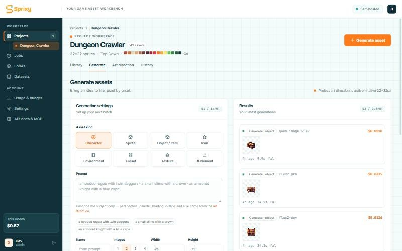
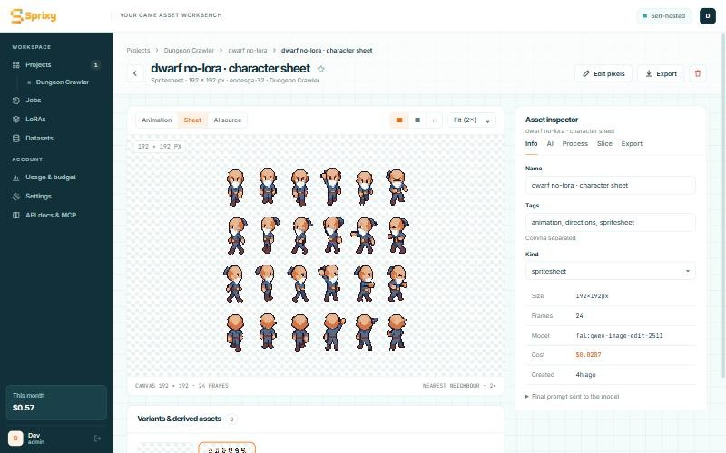
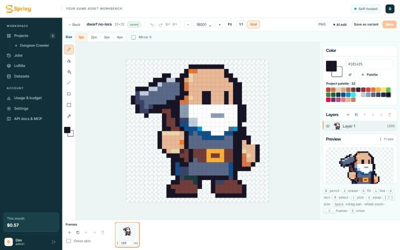

## Projects and art direction

A project groups the assets of one game and carries its **[[art direction]]**, edited under **Art direction**:

- **Palette** — a preset (Endesga 32, PICO-8, Sweetie 16…), colours extracted from an image, or a `.hex` / `.gpl` file.
  With *enforce*, every result is mapped onto it.
- **Sizes** — native sprite, icon, tile and scene sizes. Results are snapped to these grids.
- **Perspective, lighting, shading, detail, outline** — written into every prompt.
- **References** — up to four library images the edit models imitate.
- **Preferred models and [[LoRAs|lora]]** — used unless a job says otherwise.

:::why Why describe only the subject?
Sprixy builds the full prompt from the art direction: "pixel art game character sprite of …, 32x32, top-down view,
cel shading, 1-pixel outline, limited palette (Endesga 32), plain flat magenta background…". You write
"a goblin archer"; consistency comes for free. The exact prompt is shown under the results.
:::

## Generate

**Generate** takes a kind (Character, Sprite, Object, Environment, Tileset, Texture, UI, Icon), a prompt, a count
(1–4), the native size, a model, LoRAs, style references, a seed and the free post-processing options. The estimate
updates as you type; **Ctrl/⌘ + Enter** starts the job. Results appear on the right as they finish.

## The library

The library lists the project's assets with their kind, size, frames, tags and date; click one to see it in the
inspector (preview, prompt, model, palette, tags) and double-click to open it. Filter by kind, collection, tag or
favourites, switch between list and grid, and tick several assets for batch actions: tag, favourite, move to a
collection, apply a palette or a processing pipeline, make an animation, export as a ZIP, delete.

**Import** brings in existing images, optionally converted to true pixel art for free. **Draw** opens the editor on a
blank sprite.

## An asset

The asset page shows the sprite at any zoom on a checkerboard, dark or light background, its AI source, its variants
and everything derived from it. The panel on the right has five tabs:

| Tab | What it does |
| --- | --- |
| **Info** | Name, tags, kind, model, seed, cost, palette and the exact prompt |
| **AI** | Variant, Directions (4 or 8, west views mirrored for free), Animate, Cutout |
| **Process** | The free pipeline, previewed live, saved in place or as a variant |
| **Slice** | Cut a sprite sheet into frames (grid or automatic) and align them |
| **Export** | Every format, at any integer scale |

## Animate

Three methods, under **AI → Animate**:

- **Video** — Wan 2.2 animates the sprite; frames are extracted, pixelized and locked to its palette. Any action:
  "idle breathing", "sword attack"…
- **Sprite sheet** — an edit model draws N frames at once.
- **[[Character sheet|character-sheet]]** — one call returns 24 frames of 32×48: walk, attack and hurt in four
  directions, plus a looping walk animation per direction.

## Edit pixels

The editor has pencil, eraser, fill, line, rectangle, selection, move, eyedropper and mirror tools, layers with
opacity, frames with onion skin and timing, the project palette, and undo history. Select a region and use
**AI edit** to repaint it from a prompt: pixels outside the selection never change.

## Autotiles

In the library, **Autotile** builds a 16-tile [[Wang|wang]] corner set from two textures (for example grass and dirt),
for free. The Godot export includes a TileSet with terrains, the Phaser and ZIP exports a Tiled wangset.

## Export

| Format | Contents |
| --- | --- |
| PNG, GIF, WebP | One image (animated when the asset has frames) |
| Sprite sheet | Packed PNG + JSON atlas |
| Godot 4 | PNG, `.import`, SpriteFrames or TileSet `.tres` with terrains |
| Unity | PNG + `.meta` with Point filtering and sprite rects |
| Phaser | Atlas, animations JSON, loader snippet, Tiled `.tsx` for tiles |
| Aseprite | `.aseprite` with layers and frames |
| ZIP | Everything, with individual frames |

Several assets can be exported at once from the library.
