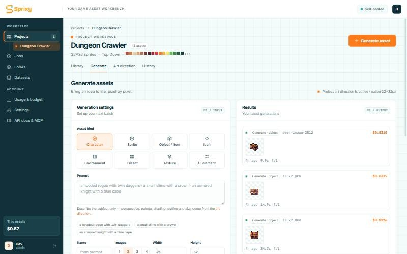

Sprixy makes 2D game assets — sprites, characters, objects, tilesets, textures, UI, animations and 4-direction
character sheets — with AI models you choose, then turns them into **true pixel art**: a real pixel grid, your
palette, a clean cutout. It runs on your own server and on your own provider keys ([[BYOK]]): no GPU, no subscription.

:::cards cols=2
- [Getting started](getting-started.md) Deploy it, add a key, generate your first sprite in five minutes.
- [User guide](guide.md) Projects, art direction, generation, editing, animation and exports.
- [Deploy](deployment.md) Coolify or Docker Compose: one container, one volume.
- [Providers & models](providers.md) fal.ai and OpenRouter, prices, real-run comparisons, LoRAs.
- [REST API](api.md) Drive Sprixy from Mocky, Muse or any tool.
- [MCP server](mcp.md) Let Claude Code create and export assets for you.
:::

## What it does

- **Pixel-perfect by default.** Every AI image goes through a free, deterministic pipeline: background removal,
  snapping to the native grid, palette mapping with optional dithering, orphan-pixel cleanup, outline.
- **Your art direction, everywhere.** Each project keeps its palette, sprite size, perspective, shading, outline,
  references, preferred models and [[LoRAs|lora]]; every prompt is built from it.
- **Any model.** Z-Image Turbo, FLUX.2 klein / dev / pro, Qwen Image, Wan video, BiRefNet, and every OpenRouter image
  model — with live prices and a cost estimate before each job.
- **Characters that move.** 4 or 8 directions, video or sprite-sheet animations, and one-call
  [[character sheets|character-sheet]] (walk, attack, hurt × 4 directions).
- **Tiles that connect.** 16-tile [[Wang autotiles|wang]] from two textures, with Godot terrains and Tiled wangsets.
- **A real editor.** Layers, frames, onion skin, palette lock, and AI edit of a selection.
- **Straight into your engine.** PNG, GIF, WebP, sprite sheets + JSON, Godot, Unity, Phaser, Tiled, `.aseprite`.
- **Costs under control.** Estimates, daily / monthly / per-job budgets, and your provider balance in the top bar.

:::why Why self-hosted and BYOK?
PixelLab and Retro Diffusion are good, but closed: you pay their margin, use their models, and your assets live on
their servers. Sprixy keeps the useful ideas (see the [competitive analysis](competitive-analysis.md)) and gives you the
choice of model, the raw costs and your data.
:::
