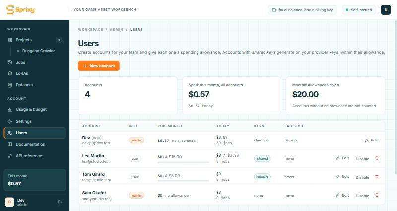

The first account of an instance is its administrator. From **Users** in the sidebar (administrators only), you
create the other accounts — sign-ups can stay closed — and decide how much each one may spend.

## Create an account

:::steps
1. **Users → New account.** Enter a name, an email and a password of at least 8 characters.
2. **Choose the role.** A *user* sees only their own projects, assets, LoRAs and jobs. An *admin* can also manage
   accounts.
3. **Set the allowance.** A monthly amount in US dollars, and optionally a daily one. Leave a field empty for no limit.
4. **Shared keys.** Ticked, the account generates on the administrators' fal.ai and OpenRouter keys when it has none
   of its own.
5. **Hand over the credentials.** The person signs in with this email and password, then changes the password under
   **Settings → Account**.
:::

## Allowances

An allowance is a hard limit. Before every AI job, Sprixy adds the job's estimate to what the account has already
spent this month (or today) and refuses the job — HTTP 402, nothing is sent to the provider — when the total would go
over. Jobs still running count at their estimate, finished ones at their real cost.

The account sees its allowance in the top bar (*Allowance left*), in the sidebar and on **Usage & budget**. It can set
lower limits for itself there — a per-job cap, a daily job count — but never raise yours.

:::tip
The **Users** page shows each account's spend this month against its allowance, its spend and jobs today and its last
job, plus the total of all accounts and of the allowances you gave.
:::

## Shared keys

With shared keys, an account without its own key uses the key of the administrator who created it, or else of the
oldest administrator holding one. Your keys never leave the server and stay invisible to the account, and so does your
provider balance: it sees *shared by your administrator* in Settings and its allowance in the top bar. An account
that adds its own key uses it from then on, still within its allowance.

:::warning
Shared keys spend your provider credit. Give an allowance to every account that uses them: an account with shared
keys and no allowance can spend until your provider balance runs out.
:::

## Change, disable, delete

- **Edit** changes the name, role, allowance and shared keys, or sets a new password. A new password signs the
  account out everywhere.
- **Disable** blocks sign-in and API tokens at once, and keeps everything. **Enable** restores access.
- **Delete** removes the account with all its projects, assets, files, LoRAs, keys and tokens. It cannot be undone,
  and it waits until the account has no job running.

You cannot remove your own admin role, disable or delete your own account, so an instance always keeps an
administrator.

## API

The same actions are available to administrators over the REST API — see [Administration](api.md#administration).
