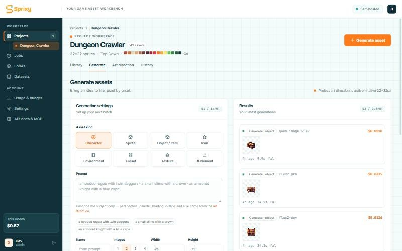
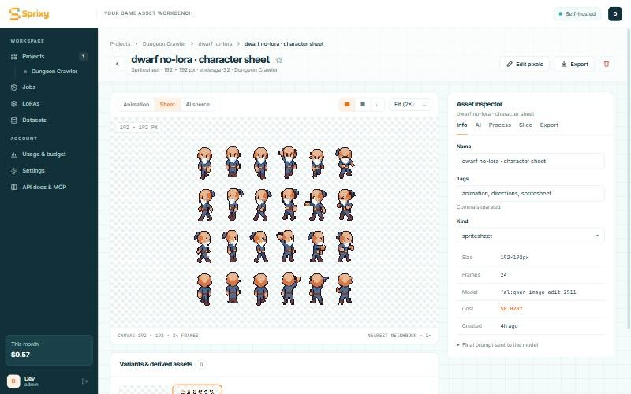
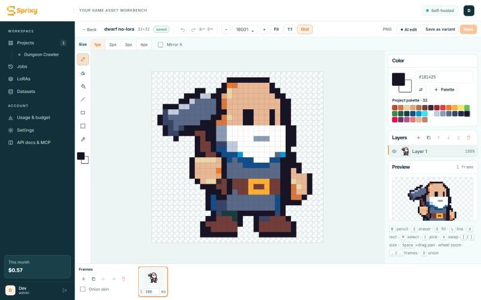

## Projets et direction artistique

Un projet regroupe les assets d'un jeu et porte sa **[[direction artistique|art-direction]]**, modifiable dans
**Art direction** (Direction artistique) :

- **Palette** — un préréglage (Endesga 32, PICO-8, Sweetie 16…), des couleurs extraites d'une image, ou un fichier
  `.hex` / `.gpl`. Avec *enforce* (imposer), chaque résultat y est ramené.
- **Tailles** — tailles natives des sprites, icônes, tuiles et scènes. Les résultats sont alignés sur ces grilles.
- **Perspective, éclairage, ombrage, niveau de détail, contour** — inscrits dans chaque prompt.
- **Références** — jusqu'à quatre images de la bibliothèque que les modèles d'édition imitent.
- **Modèles et [[LoRA|lora]] préférés** — utilisés sauf indication contraire d'une tâche.

:::why Pourquoi ne décrire que le sujet ?
Sprixy construit le prompt complet à partir de la direction artistique : « pixel art game character sprite of …, 32x32,
top-down view, cel shading, 1-pixel outline, limited palette (Endesga 32), plain flat magenta background… ». Vous
écrivez « un archer gobelin » ; la cohérence vient toute seule. Le prompt exact s'affiche sous les résultats.
:::

## Générer

**Generate** (Générer) prend un type (Character, Sprite, Object, Environment, Tileset, Texture, UI, Icon), un prompt,
un nombre (1 à 4), la taille native, un modèle, des LoRA, des références de style, une graine (seed) et les options de
post-traitement gratuites. L'estimation se met à jour pendant la saisie ; **Ctrl/⌘ + Entrée** lance la tâche. Les
résultats apparaissent à droite au fur et à mesure.

## La bibliothèque

La bibliothèque (**Library**) liste les assets du projet avec leur type, leur taille, leurs images, leurs tags et leur
date ; cliquez sur l'un d'eux pour le voir dans l'inspecteur (aperçu, prompt, modèle, palette, tags) et double-cliquez
pour l'ouvrir. Filtrez par type, collection, tag ou favoris, basculez entre liste et grille, et cochez plusieurs assets
pour des actions groupées : ajouter un tag, mettre en favori, déplacer vers une collection, appliquer une palette ou
une chaîne de traitement, créer une animation, exporter en ZIP, supprimer.

**Import** (Importer) fait entrer des images existantes, éventuellement converties gratuitement en vrai pixel art.
**Draw** (Dessiner) ouvre l'éditeur sur un sprite vierge.

## Un asset

La page d'un asset affiche le sprite à n'importe quel zoom sur un damier, un fond sombre ou clair, sa source IA, ses
variantes et tout ce qui en dérive. Le panneau de droite comporte cinq onglets :

| Onglet | Ce qu'il fait |
| --- | --- |
| **Info** | Nom, tags, type, modèle, graine, coût, palette et prompt exact |
| **AI** | Variant (variante), Directions (4 ou 8, vues ouest obtenues gratuitement par symétrie), Animate (animer), Cutout (détourer) |
| **Process** | La chaîne de traitement gratuite, prévisualisée en direct, enregistrée sur place ou comme variante |
| **Slice** | Découper une planche de sprites en images (grille ou automatique) et les aligner |
| **Export** | Tous les formats, à n'importe quelle échelle entière |

## Animer

Trois méthodes, dans **AI → Animate** :

- **Vidéo** — Wan 2.2 anime le sprite ; les images sont extraites, pixellisées et verrouillées sur sa palette.
  N'importe quelle action : « respiration au repos », « attaque à l'épée »…
- **Planche de sprites** — un modèle d'édition dessine N images d'un coup.
- **[[Fiche personnage|character-sheet]]** — un seul appel renvoie 24 images de 32×48 : marche, attaque et dégâts dans
  quatre directions, plus une animation de marche en boucle par direction.

## Retoucher les pixels

L'éditeur propose les outils crayon, gomme, remplissage, ligne, rectangle, sélection, déplacement, pipette et miroir,
des calques avec opacité, des images avec pelure d'oignon et durée, la palette du projet et un historique d'annulation.
Sélectionnez une zone et utilisez **AI edit** (retouche IA) pour la repeindre à partir d'un prompt : les pixels hors de
la sélection ne changent jamais.

## Autotiles

Dans la bibliothèque, **Autotile** construit gratuitement un jeu de coins [[Wang|wang]] de 16 tuiles à partir de deux
textures (par exemple herbe et terre). L'export Godot inclut un TileSet avec terrains ; les exports Phaser et ZIP, un
wangset Tiled.

## Exporter

| Format | Contenu |
| --- | --- |
| PNG, GIF, WebP | Une image (animée si l'asset a plusieurs images) |
| Planche de sprites | PNG compacté + atlas JSON |
| Godot 4 | PNG, `.import`, SpriteFrames ou TileSet `.tres` avec terrains |
| Unity | PNG + `.meta` avec filtrage Point et rectangles de sprites |
| Phaser | Atlas, JSON d'animations, extrait de code de chargement, `.tsx` Tiled pour les tuiles |
| Aseprite | `.aseprite` avec calques et images |
| ZIP | Tout, avec les images individuelles |

Plusieurs assets peuvent être exportés d'un coup depuis la bibliothèque.
