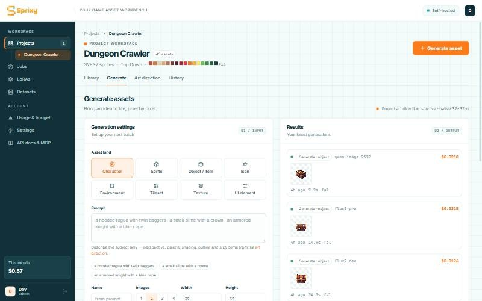

Sprixy crée des assets de jeu 2D — sprites, personnages, objets, tilesets, textures, interfaces, animations et
fiches personnage en 4 directions — avec les modèles d'IA de votre choix, puis les transforme en
**vrai pixel art** : une vraie grille de pixels, votre palette, un détourage net. Il tourne sur votre propre serveur et
avec vos propres clés de fournisseur ([[BYOK]]) : pas de GPU, pas d'abonnement.

:::cards cols=2
- [Prise en main](getting-started.md) Déployez-le, ajoutez une clé et générez votre premier sprite en cinq minutes.
- [Guide d'utilisation](guide.md) Projets, direction artistique, génération, édition, animation et exports.
- [Déployer](deployment.md) Coolify ou Docker Compose : un conteneur, un volume.
- [Fournisseurs et modèles](providers.md) fal.ai et OpenRouter, tarifs, comparaisons sur essais réels, LoRA.
- [API REST](api.md) Pilotez Sprixy depuis Mocky, Muse ou n'importe quel outil.
- [Serveur MCP](mcp.md) Laissez Claude Code créer et exporter des assets pour vous.
:::

## Ce que fait Sprixy

- **Pixel parfait par défaut.** Chaque image d'IA passe par une chaîne de traitement gratuite et déterministe :
  suppression du fond, alignement sur la grille native, application de la palette avec tramage optionnel, nettoyage
  des pixels isolés, contour.
- **Votre direction artistique, partout.** Chaque projet conserve sa palette, sa taille de sprite, sa perspective, son
  ombrage, son contour, ses références, ses modèles préférés et ses [[LoRA|lora]] ; chaque prompt est construit à
  partir d'eux.
- **N'importe quel modèle.** Z-Image Turbo, FLUX.2 klein / dev / pro, Qwen Image, Wan vidéo, BiRefNet et tous les
  modèles d'image d'OpenRouter — avec les prix en direct et une estimation du coût avant chaque tâche.
- **Des personnages qui bougent.** 4 ou 8 directions, animations par vidéo ou par planche de sprites, et
  [[fiches personnage|character-sheet]] en un seul appel (marche, attaque, dégâts × 4 directions).
- **Des tuiles qui se raccordent.** [[Autotiles de Wang|wang]] de 16 tuiles à partir de deux textures, avec terrains
  Godot et wangsets Tiled.
- **Un vrai éditeur.** Calques, images, pelure d'oignon, verrouillage de la palette et retouche par IA d'une sélection.
- **Directement dans votre moteur.** PNG, GIF, WebP, planches de sprites + JSON, Godot, Unity, Phaser, Tiled,
  `.aseprite`.
- **Des coûts maîtrisés.** Estimations, budgets quotidien / mensuel / par tâche, et le solde de votre fournisseur dans
  la barre du haut.

:::why Pourquoi l'auto-hébergement et le BYOK ?
PixelLab et Retro Diffusion sont de bons outils, mais fermés : vous payez leur marge, utilisez leurs modèles, et vos
assets vivent sur leurs serveurs. Sprixy reprend les bonnes idées (voir l'[analyse concurrentielle](competitive-analysis.md))
et vous laisse le choix du modèle, les coûts bruts et la maîtrise de vos données.
:::
