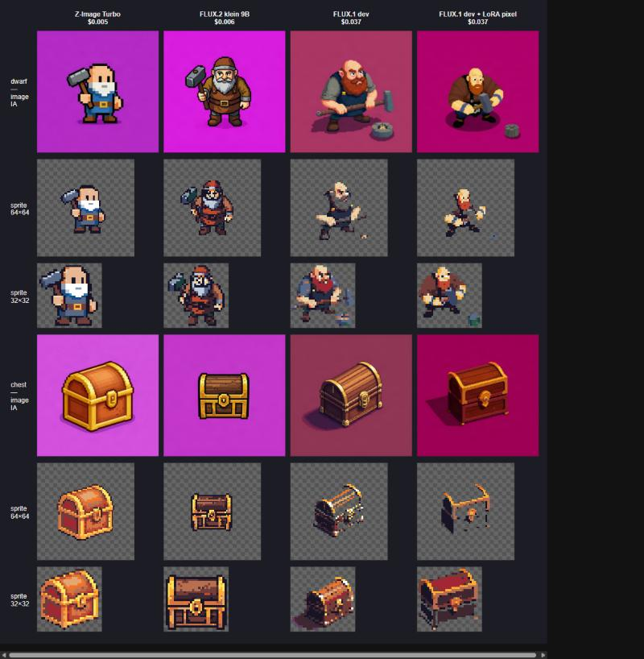
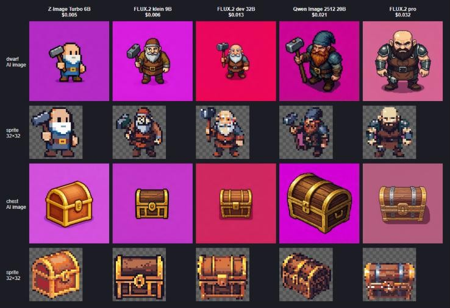
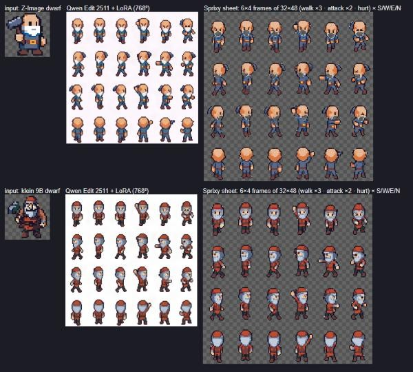

Sprixy fonctionne en **BYOK** : chaque utilisateur enregistre ses propres clés de fournisseur (Settings → Provider
keys). Les clés sont validées auprès du fournisseur, chiffrées en AES-256-GCM et jamais renvoyées au navigateur. La
génération est facturée par le fournisseur sur le compte de l'utilisateur ; Sprixy enregistre les coûts estimés et
réels de chaque tâche et fait respecter les budgets.

## fal.ai

API REST de file d'attente (`https://queue.fal.run/{endpoint}`), `Authorization: Key …`. Les images d'entrée sont
envoyées sur le stockage fal (solution de repli : URI data). Les URL de statut et de résultat renvoyées par l'appel de
soumission sont conservées pour que les tâches puissent reprendre après un redémarrage. Les prix unitaires sont
actualisés depuis la Platform API de fal (`GET https://api.fal.ai/v1/models/pricing`) quand une clé est disponible ;
sinon, les prix catalogue ci-dessous sont utilisés (signalés « list price » dans l'interface).

| Identifiant Sprixy | Endpoint(s) | Capacités | Prix catalogue |
| --- | --- | --- | --- |
| `fal:z-image-turbo` | `fal-ai/z-image/turbo`, `…/lora` | txt2img, jusqu'à 3 LoRA | 0,005 $/MP, LoRA 0,0085 $/MP |
| `fal:z-image-turbo-i2i` | `fal-ai/z-image/turbo/image-to-image`, `…/lora` | img2img (variantes) | 0,005 $/MP, LoRA 0,0085 $/MP |
| `fal:flux2-klein-4b` | `fal-ai/flux-2/klein/4b`, `/lora`, `/edit`, `/edit/lora` | txt2img, édition multi-références | 0,005 $/MP (édition 0,01 $/MP) |
| `fal:flux2-klein-9b` | `fal-ai/flux-2/klein/9b`, `/lora`, `/edit`, `/edit/lora` | txt2img, édition, directions | 0,006 $/MP (édition 0,011 $/MP entrée+sortie) |
| `fal:flux2-dev` | `fal-ai/flux-2`, `/lora`, `/edit`, `/lora/edit` | 32B : txt2img, édition, LoRA FLUX.2 dev | 0,012 $/MP, LoRA 0,021 $/MP |
| `fal:flux2-pro` | `fal-ai/flux-2-pro`, `/edit` | txt2img, édition (pas de LoRA, une image par appel) | 0,03 $/MP traité |
| `fal:qwen-image-2512` | `fal-ai/qwen-image-2512`, `/lora` | txt2img 20B, LoRA Qwen-Image | 0,02 $/MP, LoRA 0,035 $/MP |
| `fal:qwen-image-edit-2511` | `fal-ai/qwen-image-edit-2511`, `/lora` | édition 20B, fiches personnage | 0,03 $/MP, LoRA 0,035 $/MP |
| `fal:flux1-dev-lora` | `fal-ai/flux-lora` | txt2img avec LoRA FLUX.1 | ≈ 0,035 $/MP |
| `fal:wan-2.2-i2v` | `fal-ai/wan/v2.2-a14b/image-to-video` | animation (contrôle des images et des fps) | 0,04–0,08 $/s (facturé à 16 fps) |
| `fal:wan-2.6-i2v` | `wan/v2.6/image-to-video` | animation (clips de 5 s) | 0,10–0,15 $/s |
| `fal:birefnet-v2` | `fal-ai/birefnet/v2` | suppression du fond par IA | selon l'API de tarifs |
| `fal:z-image-trainer` | `fal-ai/z-image-trainer` | entraînement de LoRA (famille z-image) | 2,26 $ / 1000 étapes |
| `fal:flux2-klein-9b-trainer` | `fal-ai/flux-2-klein-9b-base-trainer` | entraînement de LoRA (flux2-klein-9b) | 4,30 $ / 1000 étapes |
| `fal:flux1-fast-trainer` | `fal-ai/flux-lora-fast-training` | entraînement de LoRA (flux1) | ≈ 2 $ / exécution |

Les prix changent : fiez-vous toujours à l'estimation dans l'application (qui indique si elle provient de l'API de
tarifs en direct) et à votre tableau de bord fal.

### Le solde dans la barre du haut {#balance-in-the-top-bar}

Sprixy affiche le crédit fal.ai restant dans sa barre du haut (en orange sous 1 $). fal.ai n'expose la facturation
qu'aux clés de portée **ADMIN** ; une clé d'API ordinaire affiche donc « add a billing key » (ajoutez une clé de
facturation) : créez une clé ADMIN dans le tableau de bord fal.ai et collez-la dans
**Settings → Provider keys → Balance**. Elle est stockée chiffrée et sert uniquement à lire le solde, jamais à lancer
des tâches.

## OpenRouter

Les modèles capables de produire des images sont découverts dynamiquement
(`GET /api/v1/models?output_modalities=image`, mis en cache 1 h) et apparaissent dans les sélecteurs de modèles dès
qu'une clé OpenRouter est configurée : modèles d'image Google Gemini, OpenAI GPT-image, FLUX.2, Seedream, Qwen-Image,
Recraft, Grok… Les modèles qui acceptent une image en entrée reçoivent la capacité `edit` (variantes, directions,
références, animations par planche de sprites).

Les appels utilisent l'Images API (`POST /api/v1/images`), avec un repli sur les chat completions avec
`modalities: ["image","text"]`. Le **coût exact** renvoyé par OpenRouter (`usage.cost`) est enregistré ; les
estimations avant exécution sont des approximations (≈ 1290 jetons de sortie par image).

## Familles de LoRA

Une LoRA ne fonctionne qu'avec le modèle de base pour lequel elle a été entraînée. Sprixy associe chaque LoRA à une
famille et ignore discrètement (avec un avertissement visible) les LoRA qui ne correspondent pas au modèle choisi.

| Famille | Modèles | Entraîneur |
| --- | --- | --- |
| `z-image` | Z-Image Turbo (txt2img, img2img) | `fal:z-image-trainer` |
| `flux2-klein-4b` | FLUX.2 klein 4B | — (import) |
| `flux2-klein-9b` | FLUX.2 klein 9B | `fal:flux2-klein-9b-trainer` |
| `flux2-dev` | FLUX.2 dev (32B) | — (import) |
| `qwen-image` | Qwen Image 2512 (20B) | — (import) |
| `qwen-image-edit-2511` | Qwen Image Edit 2511 (20B) | — (import) |
| `flux1` | FLUX.1 dev | `fal:flux1-fast-trainer` |

LoRA communautaires préréglées (Hugging Face) : `tarn59/pixel_art_style_lora_z_image_turbo`,
`reverentelusarca/elusarca-pixel-art-style-lora-zimage-turbo`, `limbicnation/pixel-art-lora`,
`artificialguybr/PIXELART-REDMOND-ZIMAGETURBO`, `artificialguybr/PIXELART-REDMOND-FLUXKLEIN9B` et la LoRA de planche
de sprites `svntax-dev/pixel_spritesheet_4walk_combat_32x48_v1` (voir *Méthode « fiche personnage »*). Vérifiez la
licence de chacune.

Observation sur essai réel (Z-Image + `tarn59`, même graine) : la LoRA ajoute du détail à l'image brute, ce qui rend
les sprites 32×32 *moins* lisibles que sans elle. Les LoRA communautaires de pixel art deviennent intéressantes à
partir de 64 px, ou avec une échelle plus faible (≈ 0,6).

L'entraînement exige un jeu de données dont toutes les images sont confirmées comme vous appartenant ou autorisées. Le
pixel art est agrandi au plus proche voisin avant l'envoi pour que les entraîneurs voient des pixels nets.
L'estimation du coût doit être acceptée avant le début de l'entraînement.

### Entraîner hors de Sprixy (gratuit / votre propre GPU)

L'entraînement d'une LoRA demande un GPU avec environ 16 à 24 Go de VRAM pour les modèles de base actuels ; Sprixy
(qui ne demande aucun GPU) n'entraîne donc pas en local. À la place, **Datasets → Export for external training**
(`GET /api/v1/datasets/:id/export`) télécharge le jeu de données dans la structure universelle (images agrandies au
plus proche voisin + légendes `.txt` de même nom + `metadata.jsonl` + README). Entraînez-le avec ai-toolkit,
kohya-ss, OneTrainer, Civitai ou n'importe quel entraîneur — sur votre propre GPU ou du temps GPU gratuit dans un
notebook — puis utilisez **LoRAs → Import LoRA** avec la famille correspondante.

## Comparaison des modèles (essais réels, 23/11/2026) {#model-comparison-real-runs-2026-11-23}

Mêmes prompts et mêmes graines, direction artistique Sprixy (32×32, vue de dessus, Endesga 32), post-traitement par
défaut. La ligne 64×64 est une reconversion gratuite de la même image d'IA.

| Modèle | Coût / image | Résultat |
| --- | --- | --- |
| Z-Image Turbo | ~0,005 $ | Les sprites les plus nets : ombrage en aplat, proportions chibi, respecte le fond clé uni. Idéal de 16 à 32 px. **Par défaut.** |
| FLUX.2 klein 9B | ~0,006 $ | Plus de détails et des proportions plus naturelles, toujours net et bien isolé. Idéal de 48 à 64 px, ainsi que pour les éditions / références. |
| FLUX.1 dev | ~0,037 $ | Rendu pictural, pas du pixel art ; ignore « pas d'ombre / fond uni » (ombres portées, accessoires en trop, fond teinté) ; médiocre après réduction. |
| FLUX.1 dev + LoRA pixel (`UmeAiRT/FLUX.1-dev-LoRA-Modern_Pixel_art`, MIT) | ~0,037 $ | Aspect pixel art dans l'image brute, mais les mêmes problèmes de composition ; les sprites les plus faibles. |

Conclusion : FLUX.1 dev (2024) est environ 7 fois plus cher et moins bon pour les sprites de jeu que les modèles plus
récents. Il sert surtout à réutiliser une LoRA FLUX.1 existante de Civitai / Hugging Face.

### Modèles plus gros

| Modèle | Taille | Coût / image | Résultat |
| --- | --- | --- | --- |
| FLUX.2 dev | 32B | ~0,013 $ | Net et bien isolé, très proche de klein 9B ; a tendance à dessiner le sujet petit (Sprixy le recadre). Accepte les LoRA FLUX.2 dev. |
| Qwen Image 2512 | 20B | ~0,021 $ | Le pixel art le plus détaillé, mais la perspective 3/4 et les détails fins deviennent confus à 32 px — bon à partir de 64 px. Accepte les LoRA Qwen-Image. |
| FLUX.2 pro | — | ~0,032 $ | Proportions réalistes, fond teinté et ombre portée ; pas de LoRA. Ne vaut pas un prix 6 fois plus élevé pour des sprites. |

Plus gros ne veut pas dire meilleur pour les petits sprites : le détail supplémentaire est perdu quand l'image est
réduite à 32×32. Gardez Z-Image Turbo / klein 9B pour 16 à 32 px, et essayez Qwen Image 2512 ou FLUX.2 dev pour 64 px
et plus, les scènes chargées, ou les prompts que les modèles moins chers comprennent mal.

## Méthode « fiche personnage » (Qwen Image Edit 2511 + LoRA) {#character-sheet-method-qwen-image-edit-2511-lora}

`POST /api/v1/generations` avec `{ "task": "animate", "assetId": "…", "method": "charsheet" }` envoie le personnage à
Qwen Image Edit 2511 avec la LoRA [`svntax-dev/pixel_spritesheet_4walk_combat_32x48_v1`](https://huggingface.co/svntax-dev/pixel_spritesheet_4walk_combat_32x48_v1)
(Apache-2.0), en reprenant la formulation de prompt sur laquelle elle a été entraînée. Un seul appel (~0,021 $)
renvoie une planche de 6×4 images de 32×48 : pour chaque direction (sud, ouest, est, nord), 3 images de marche, 2
images d'attaque et 1 image de dégâts. Sprixy supprime le fond, l'aligne sur la grille 32×48, applique la palette et
crée :

- un asset `spritesheet` avec 24 images nommées (`walk_south_0`…, `attack_east_1`, `hurt_north`), exportable vers
  Godot / Unity / Phaser / Aseprite comme n'importe quelle planche ;
- une animation `walk <direction>` en boucle par direction.

La taille des images est imposée par la LoRA (32×48). Le personnage garde son apparence et ses couleurs, mais les
petits accessoires (comme le marteau ci-dessus) ne sont souvent dessinés que dans les images d'attaque.

## Ajouter un fournisseur

1. Créez `apps/server/src/providers/<name>.ts` en implémentant `ProviderAdapter` (`types.ts`) :
   `validateKey`, `listModels`, `estimate`, `run` (et éventuellement `resume`).
2. Faites correspondre les tâches Sprixy (`txt2img`, `edit`, `img2img`, `animate`, `removeBg`, `train`) à l'API du
   fournisseur et renvoyez un `TaskResult` (`images[]` sous forme d'URL ou de buffers, `video`, `lora`, `cost` réel
   optionnel).
3. Enregistrez-le dans `providers/registry.ts` et ajoutez son identifiant aux enums `provider` (route des clés, route
   des modèles).

Tout le reste — tâches, budgets, affichage des coûts, sélecteurs de l'interface, REST et MCP — fonctionne sans
modification.
