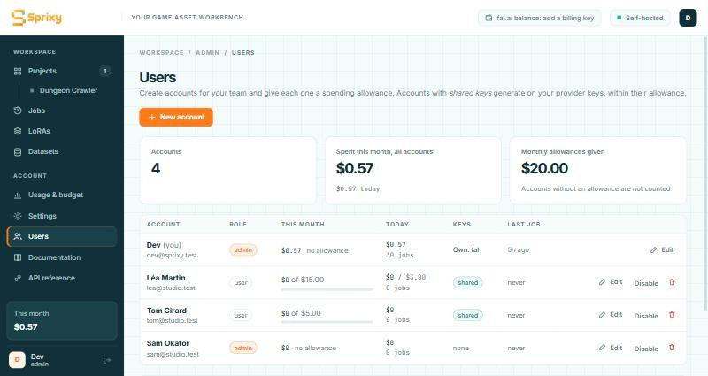

Le premier compte d'une instance en est l'administrateur. Depuis **Users** dans la barre latérale (réservé aux
administrateurs), vous créez les autres comptes — les inscriptions peuvent rester fermées — et décidez de ce que
chacun peut dépenser.

## Créer un compte

:::steps
1. **Users → New account.** Saisissez un nom, un e-mail et un mot de passe d'au moins 8 caractères.
2. **Choisissez le rôle.** Un *user* ne voit que ses propres projets, assets, LoRA et tâches. Un *admin* peut aussi
   gérer les comptes.
3. **Fixez l'enveloppe.** Un montant mensuel en dollars US, et si besoin un montant journalier. Laissez un champ vide
   pour ne pas limiter.
4. **Clés partagées.** Cochée, l'option permet au compte de générer avec les clés fal.ai et OpenRouter des
   administrateurs quand il n'a pas les siennes.
5. **Transmettez les identifiants.** La personne se connecte avec cet e-mail et ce mot de passe, puis change le mot
   de passe dans **Settings → Account**.
:::

## Enveloppes

Une enveloppe est une limite stricte. Avant chaque tâche d'IA, Sprixy ajoute l'estimation de la tâche à ce que le
compte a déjà dépensé ce mois-ci (ou aujourd'hui) et refuse la tâche — HTTP 402, rien n'est envoyé au fournisseur —
si le total la dépasserait. Les tâches en cours comptent pour leur estimation, les tâches terminées pour leur coût réel.

Le compte voit son enveloppe dans la barre du haut (*Allowance left*), dans la barre latérale et dans
**Usage & budget**. Il peut s'y fixer des limites plus basses — un plafond par tâche, un nombre de tâches par jour —
mais jamais relever les vôtres.

:::tip
La page **Users** montre, pour chaque compte, sa dépense du mois face à son enveloppe, sa dépense et ses tâches du jour
et sa dernière tâche, ainsi que le total de tous les comptes et des enveloppes accordées.
:::

## Clés partagées

Avec les clés partagées, un compte sans clé propre utilise celle de l'administrateur qui l'a créé, à défaut celle du
plus ancien administrateur qui en possède une. Vos clés ne quittent jamais le serveur et restent invisibles pour le
compte, tout comme le solde de votre fournisseur : il voit *shared by your administrator* dans Settings et son
enveloppe dans la barre du haut. Un compte qui ajoute sa propre clé l'utilise dès lors, toujours dans son enveloppe.

:::warning
Les clés partagées dépensent votre crédit chez le fournisseur. Donnez une enveloppe à chaque compte qui les utilise :
un compte avec clés partagées et sans enveloppe peut dépenser jusqu'à épuiser votre solde.
:::

## Modifier, désactiver, supprimer

- **Edit** change le nom, le rôle, l'enveloppe et les clés partagées, ou définit un nouveau mot de passe. Un nouveau
  mot de passe déconnecte le compte partout.
- **Disable** bloque aussitôt la connexion et les jetons d'API, sans rien effacer. **Enable** rétablit l'accès.
- **Delete** supprime le compte avec tous ses projets, assets, fichiers, LoRA, clés et jetons. C'est irréversible, et
  il faut attendre qu'aucune tâche du compte ne soit en cours.

Vous ne pouvez ni retirer votre propre rôle d'administrateur, ni désactiver ou supprimer votre propre compte : une
instance garde donc toujours un administrateur.

## API

Les mêmes actions sont disponibles pour les administrateurs via l'API REST — voir [Administration](api.md#administration).
