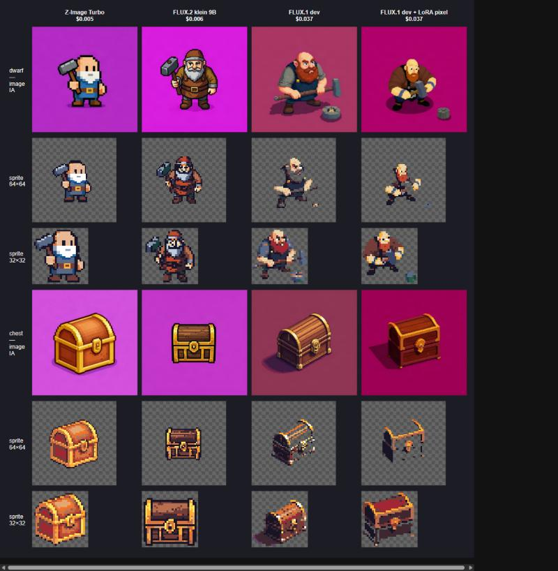
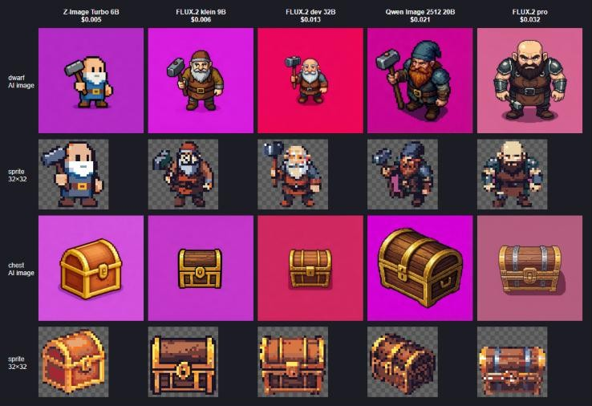
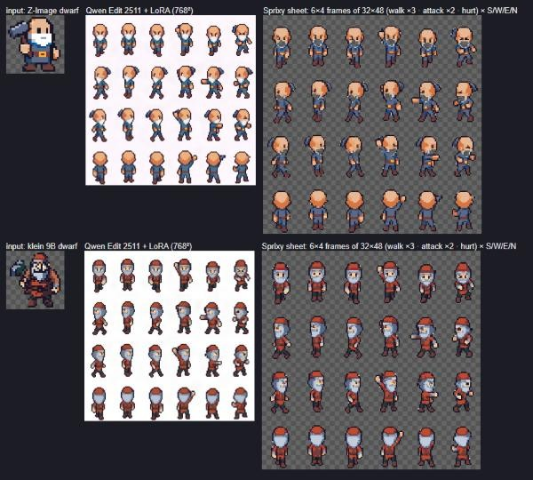

# Providers, models & pricing

Sprixy is **BYOK**: each user stores their own provider keys (Settings → Provider keys). Keys are validated against
the provider, encrypted with AES-256-GCM and never returned to the browser. Generation is billed by the provider on
the user’s own account; Sprixy records estimated and actual costs per job and enforces budgets.

## fal.ai

Queue REST API (`https://queue.fal.run/{endpoint}`), `Authorization: Key …`. Input images are uploaded to fal storage
(fallback: data URIs). Status and result URLs returned by the submit call are stored so jobs can resume after a restart.
Unit prices are refreshed from fal’s Platform API (`GET https://api.fal.ai/v1/models/pricing`) when a key is
available; otherwise the list prices below are used (marked “list price” in the UI).

| Sprixy id | Endpoint(s) | Capabilities | List price |
| --- | --- | --- | --- |
| `fal:z-image-turbo` | `fal-ai/z-image/turbo`, `…/lora` | txt2img, up to 3 LoRAs | $0.005/MP, LoRA $0.0085/MP |
| `fal:z-image-turbo-i2i` | `fal-ai/z-image/turbo/image-to-image`, `…/lora` | img2img (variants) | $0.005/MP, LoRA $0.0085/MP |
| `fal:flux2-klein-4b` | `fal-ai/flux-2/klein/4b`, `/lora`, `/edit`, `/edit/lora` | txt2img, multi-reference edit | $0.005/MP (edit $0.01/MP) |
| `fal:flux2-klein-9b` | `fal-ai/flux-2/klein/9b`, `/lora`, `/edit`, `/edit/lora` | txt2img, edit, directions | $0.006/MP (edit $0.011/MP in+out) |
| `fal:flux1-dev-lora` | `fal-ai/flux-lora` | txt2img with FLUX.1 LoRAs | ≈ $0.035/MP |
| `fal:wan-2.2-i2v` | `fal-ai/wan/v2.2-a14b/image-to-video` | animation (frames & fps control) | $0.04–0.08/s (16 fps billing) |
| `fal:wan-2.6-i2v` | `wan/v2.6/image-to-video` | animation (5 s clips) | $0.10–0.15/s |
| `fal:birefnet-v2` | `fal-ai/birefnet/v2` | AI background removal | from pricing API |
| `fal:z-image-trainer` | `fal-ai/z-image-trainer` | LoRA training (z-image family) | $2.26 / 1000 steps |
| `fal:flux2-klein-9b-trainer` | `fal-ai/flux-2-klein-9b-base-trainer` | LoRA training (flux2-klein-9b) | $4.30 / 1000 steps |
| `fal:flux1-fast-trainer` | `fal-ai/flux-lora-fast-training` | LoRA training (flux1) | ≈ $2 / run |

Prices change: always rely on the in-app estimate (which shows whether it comes from the live pricing API) and on your
fal dashboard.

### Balance in the top bar

Sprixy shows the remaining fal.ai credit in its top bar (orange under $1). fal.ai only exposes billing to **ADMIN**-scope
keys, so a regular API key shows “add a billing key”: create an ADMIN key in the fal.ai dashboard and paste it under
**Settings → Provider keys → Balance**. It is stored encrypted and used only to read the balance, never to run jobs.

## OpenRouter

Image-capable models are discovered dynamically (`GET /api/v1/models?output_modalities=image`, cached 1 h) and appear
in model pickers once an OpenRouter key is configured: Google Gemini image models, OpenAI GPT-image, FLUX.2,
Seedream, Qwen-Image, Recraft, Grok… Models accepting image input get the `edit` capability (variants, directions,
references, sprite-sheet animations).

Calls use the Images API (`POST /api/v1/images`) with a fallback to chat completions with `modalities: ["image","text"]`.
The **exact cost** returned by OpenRouter (`usage.cost`) is recorded; pre-run estimates are approximations
(≈ 1290 output tokens per image).

## LoRA families

A LoRA only works with the base model it was trained for. Sprixy tags every LoRA with a family and silently skips
(with a visible warning) LoRAs that don’t match the selected model.

| Family | Models | Trainer |
| --- | --- | --- |
| `z-image` | Z-Image Turbo (txt2img, img2img) | `fal:z-image-trainer` |
| `flux2-klein-4b` | FLUX.2 klein 4B | — (import) |
| `flux2-klein-9b` | FLUX.2 klein 9B | `fal:flux2-klein-9b-trainer` |
| `flux2-dev` | FLUX.2 dev (32B) | — (import) |
| `qwen-image` | Qwen Image 2512 (20B) | — (import) |
| `qwen-image-edit-2511` | Qwen Image Edit 2511 (20B) | — (import) |
| `flux1` | FLUX.1 dev | `fal:flux1-fast-trainer` |

Preset community LoRAs (Hugging Face): `tarn59/pixel_art_style_lora_z_image_turbo`,
`reverentelusarca/elusarca-pixel-art-style-lora-zimage-turbo`, `limbicnation/pixel-art-lora`,
`artificialguybr/PIXELART-REDMOND-ZIMAGETURBO`, `artificialguybr/PIXELART-REDMOND-FLUXKLEIN9B` and the
`svntax-dev/pixel_spritesheet_4walk_combat_32x48_v1` sprite-sheet LoRA (see *Character sheet method*). Check each license.

Real-run observation (Z-Image + `tarn59`, same seed): the LoRA adds detail to the raw image, which makes 32×32
sprites *less* readable than without it. Community pixel-art LoRAs pay off at 64 px and above, or at a lower scale
(≈ 0.6).

Training requires a dataset whose images are all confirmed as owned/authorized. Pixel art is upscaled with
nearest-neighbour before upload so trainers see crisp pixels. The cost estimate must be accepted before training starts.

### Training outside Sprixy (free / own GPU)

LoRA training needs a GPU with roughly 16–24 GB of VRAM for current base models, so Sprixy (which requires no GPU)
does not train locally. Instead, **Datasets → Export for external training** (`GET /api/v1/datasets/:id/export`)
downloads the dataset in the universal layout (nearest-neighbour upscaled images + same-name `.txt` captions +
`metadata.jsonl` + README). Train it with ai-toolkit, kohya-ss, OneTrainer, Civitai or any trainer — on your own
GPU or free notebook GPU time — then use **LoRAs → Import LoRA** with the matching family.

## Model comparison (real runs, 2026-11-23)

Same prompts and seeds, Sprixy art direction (32×32, top-down, Endesga 32), default post-processing. The 64×64 row
is a free re-conversion of the same AI image.

| Model | Cost / image | Result |
| --- | --- | --- |
| Z-Image Turbo | ~$0.005 | Cleanest sprites: flat shading, chibi proportions, respects the flat key background. Best at 16–32 px. **Default.** |
| FLUX.2 klein 9B | ~$0.006 | More detail and more natural proportions, still clean and isolated. Best at 48–64 px, and for edits / references. |
| FLUX.1 dev | ~$0.037 | Painterly, not pixel art; ignores “no shadow / flat background” (cast shadows, extra props, tinted background); poor after downscaling. |
| FLUX.1 dev + pixel LoRA (`UmeAiRT/FLUX.1-dev-LoRA-Modern_Pixel_art`, MIT) | ~$0.037 | Pixel-art look in the raw image, but the same composition issues; the weakest sprites. |

Conclusion: FLUX.1 dev (2024) is ~7× more expensive and worse for game sprites than the newer models. It is mainly
useful for reusing an existing FLUX.1 LoRA from Civitai / Hugging Face.

### Larger models

| Model | Size | Cost / image | Result |
| --- | --- | --- | --- |
| FLUX.2 dev | 32B | ~$0.013 | Clean and well isolated, very close to klein 9B; tends to draw the subject small (Sprixy crops it). Takes FLUX.2 dev LoRAs. |
| Qwen Image 2512 | 20B | ~$0.021 | The most detailed pixel art, but 3/4 perspective and fine detail get muddy at 32 px — good at 64 px+. Takes Qwen-Image LoRAs. |
| FLUX.2 pro | — | ~$0.032 | Realistic proportions, tinted background and drop shadow; no LoRAs. Not worth 6× the price for sprites. |

Bigger is not better for small sprites: the extra detail is thrown away when the image is reduced to 32×32. Keep
Z-Image Turbo / klein 9B for 16–32 px, and try Qwen Image 2512 or FLUX.2 dev for 64 px+, busy scenes, or prompts
that cheaper models misread.

## Character sheet method (Qwen Image Edit 2511 + LoRA)

`POST /api/v1/generations` with `{ "task": "animate", "assetId": "…", "method": "charsheet" }` sends the character to
Qwen Image Edit 2511 with the [`svntax-dev/pixel_spritesheet_4walk_combat_32x48_v1`](https://huggingface.co/svntax-dev/pixel_spritesheet_4walk_combat_32x48_v1)
LoRA (Apache-2.0), using the prompt wording it was trained on. One call (~$0.021) returns a 6×4 sheet of 32×48 frames:
for each direction (south, west, east, north) 3 walk frames, 2 attack frames and 1 hurt frame. Sprixy removes the
background, snaps it to the 32×48 grid, applies the palette and creates:

- a `spritesheet` asset with 24 named frames (`walk_south_0`…, `attack_east_1`, `hurt_north`), exportable to
  Godot / Unity / Phaser / Aseprite like any sheet;
- one looping `walk <direction>` animation per direction.

The frame size is fixed by the LoRA (32×48). The character keeps its look and colors, but small props (like the
hammer above) are often only drawn in the attack frames.

## Adding a provider

1. Create `apps/server/src/providers/<name>.ts` implementing `ProviderAdapter` (`types.ts`):
   `validateKey`, `listModels`, `estimate`, `run` (and optionally `resume`).
2. Map Sprixy tasks (`txt2img`, `edit`, `img2img`, `animate`, `removeBg`, `train`) to the provider’s API and return
   `TaskResult` (`images[]` as URLs or buffers, `video`, `lora`, optional real `cost`).
3. Register it in `providers/registry.ts` and add its id to the `provider` enums (keys route, models route).

Everything else — jobs, budgets, cost display, UI pickers, REST and MCP — works unchanged.
